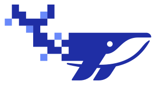

<p align="center">
  <picture>
    <source media="(prefers-color-scheme: dark)" srcset="assets/brand/logo.svg">
    
  </picture>
</p>

<h1 align="center">Whalescale</h1>

<p align="center">
  <strong>Your own private network, self-hosted.</strong><br>
  A WireGuard mesh VPN with its control server, relay, web console and clients, all yours.
</p>

<p align="center">
  <a href="https://github.com/k4ran909/WhaleScale/releases/latest"></a>
  <a href="https://ci.fluxnat.dev/repos/1"></a>
  
  
</p>

<p align="center">
  <a href="docs/getting-started.md">Getting started</a> ·
  <a href="docs/README.md">Documentation</a> ·
  <a href="https://github.com/k4ran909/WhaleScale/releases/latest">Download</a> ·
  <a href="plan.md">Roadmap</a>
</p>

---

Whalescale connects your computers, servers and phones into one private network, wherever they are. Devices talk to each other directly over WireGuard, find their way through routers and NATs on their own, and fall back to a relay only when they must. One server binary runs everything, with SQLite, or PostgreSQL for several servers.

## Features

- **Mesh networking:** direct WireGuard paths with NAT traversal; relay fallback over WebSocket or QUIC; peer relays; roaming and multipath.
- **Names, not addresses:** MagicDNS gives every device a name, like `laptop.whale.internal`.
- **Access control:** a policy with tests and "why can't A reach B?" explanations, temporary access, device posture and network lock.
- **Reach more:** subnet routers into whole LANs, exit nodes, and a gateway that publishes a service on the internet with HTTPS.
- **SSH by identity:** no keys to manage, with recorded sessions.
- **Web console:** setup in the browser, two-factor sign-in, an audit log and flow logs.
- **Easy clients:** a Windows installer and tray icon, one command on macOS and Linux, `.deb` and `.rpm` packages, and signed updates.
- **Runs anywhere:** one command on Linux, Docker, Dokploy or Kubernetes, with failover across servers.
- **Automation:** an admin API, a Terraform provider and an MCP server for AI agents.

## Quick start

**1. Run the server.** On a Linux machine whose domain points at it:

```bash
curl -fsSL https://raw.githubusercontent.com/k4ran909/WhaleScale/main/deploy/install.sh | sh -s -- --server --domain ws.example.com
```

It prints a setup code. Open `https://ws.example.com` and create your admin account with it.

**2. Add devices.** In the dashboard, **Machines → Add device** gives a join code:

| Device | Install |
|---|---|
| Windows | [`whalescale-setup-windows-amd64.exe`](https://github.com/k4ran909/WhaleScale/releases/latest), then paste the join code |
| macOS, Linux | `curl -fsSL https://raw.githubusercontent.com/k4ran909/WhaleScale/main/deploy/install.sh \| sh -s -- --join <code>` |
| Debian, Ubuntu, Fedora, RHEL | or the [`.deb` and `.rpm` packages](docs/guides/devices.md#linux-packages), then `sudo ws login <code>` |

**3. Connect.** `ping laptop.whale.internal`

The full walkthrough is in **[Getting started](docs/getting-started.md)**. Other ways to install: [Docker](docs/install/docker.md), [Dokploy](docs/install/dokploy.md), [Kubernetes](docs/install/kubernetes.md).

## Documentation

| | |
|---|---|
| **Install** | [Linux, one command](docs/install/linux.md) · [Docker](docs/install/docker.md) · [Dokploy](docs/install/dokploy.md) · [Kubernetes](docs/install/kubernetes.md) |
| **Use** | [Devices](docs/guides/devices.md) · [Web console](docs/guides/console.md) · [Access policy](docs/guides/access-policy.md) · [Networking](docs/guides/networking.md) · [SSH](docs/guides/ssh.md) · [Gateway](docs/guides/gateway.md) |
| **Operate** | [Security features](docs/guides/security.md) · [Monitoring](docs/guides/monitoring.md) · [High availability](docs/guides/high-availability.md) · [Automation](docs/guides/automation.md) |
| **Understand** | [Architecture](docs/reference/architecture.md) · [Security review](docs/reference/security-review.md) · [Known gaps](docs/reference/known-gaps.md) |
| **Contribute** | [Contributing](docs/development/contributing.md) · [CI](docs/development/ci.md) · [Roadmap](plan.md) |

## Repository

```
cmd/          whalescale (server) · wsd (agent) · ws (CLI) · whalescale-tray (Windows)
internal/     server, control plane, policy, data path, DNS, store
web/          the web console (React + TypeScript), embedded in the server
deploy/       install script, Docker Compose, Helm chart, systemd unit, example config
packaging/    Windows installer, Linux packages, release notes, release signing key
terraform/    Terraform / OpenTofu provider
docs/         the documentation
```

## Security

Releases are signed: `checksums.txt.minisig` proves the checksums came from the [Whalescale release key](packaging/release-key.pub), and the tray icon's updater checks it before installing anything ([how to verify a download](docs/guides/devices.md#verifying-downloads)). The [security review](docs/reference/security-review.md) covers the threat model and what the server can and can't see.

## Status

Whalescale is in active development, toward a 1.0 release ([roadmap](plan.md)). It's feature-complete for a self-hosted mesh, but parts haven't run on real networks yet: see [known gaps](docs/reference/known-gaps.md).

## License

No license has been chosen yet ([plan.md, open question 1](plan.md#9-open-questions)). Until one is, all rights are reserved.
