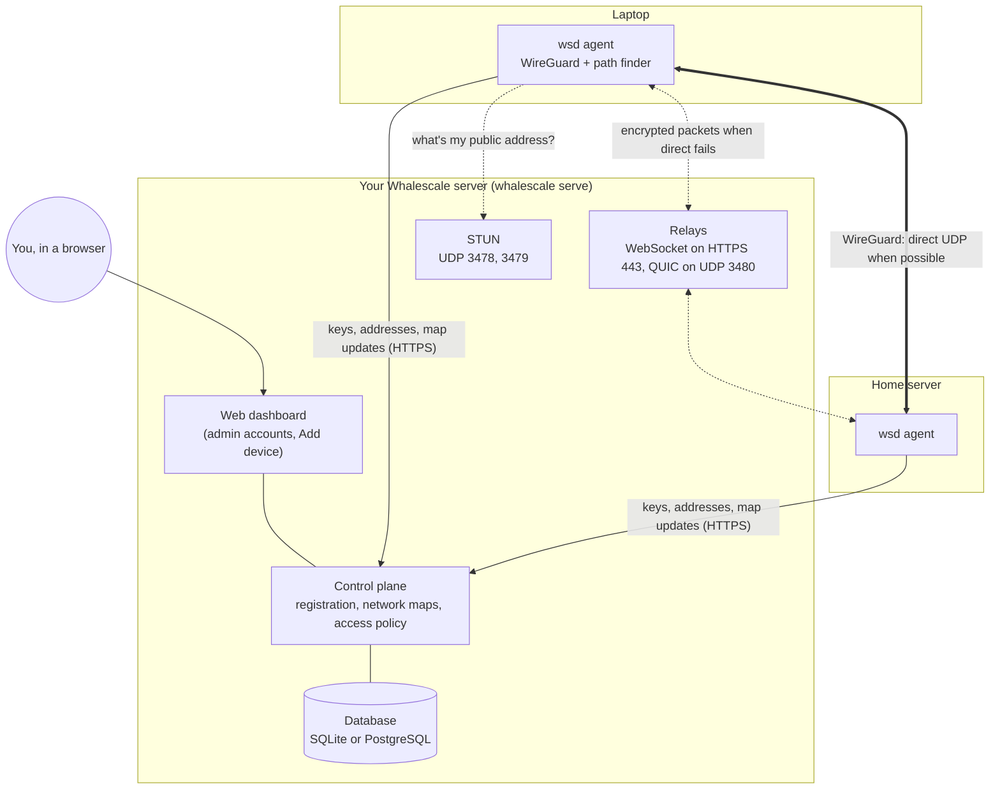
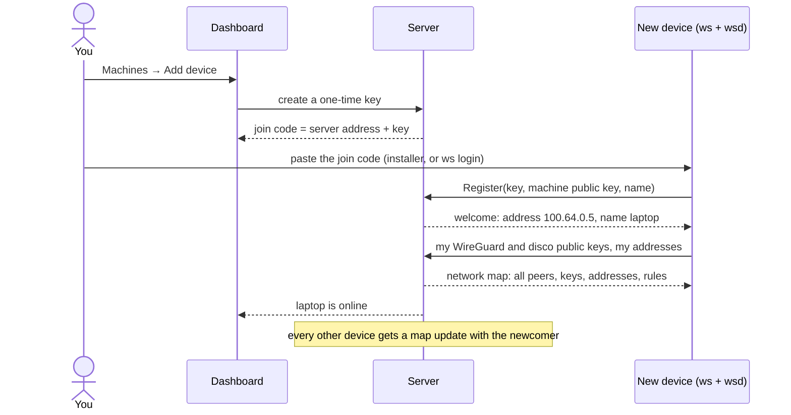
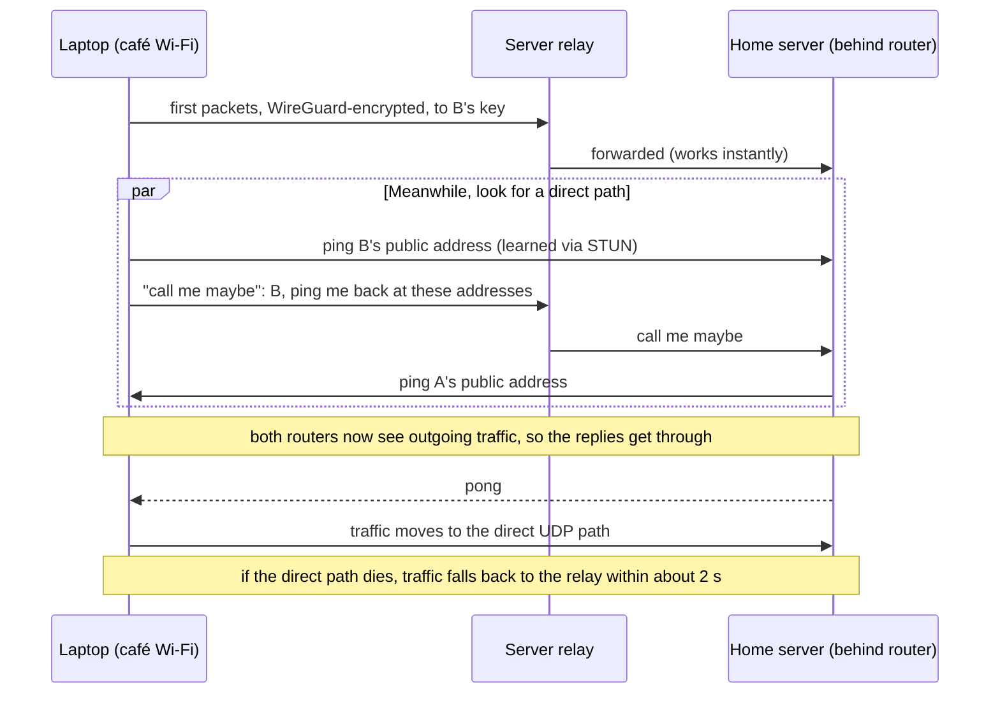

# How Whalescale works

Whalescale connects your devices into one private network, wherever they are: home, office, phone hotspot, a cloud server. Every device gets an address like `100.64.0.5` and a name like `laptop.whale.internal`, and can reach the others as if they were all plugged into the same switch.

It works the way Tailscale does. Your Whalescale server plays the part of Tailscale's coordination service (as Headscale does), and also runs the relays (Tailscale's DERP).

## The pieces

| Piece | Runs on | Does |
|---|---|---|
| **`whalescale`** | your server | Keeps the list of devices, hands out addresses, sends every device a *network map* (who else exists, their keys and addresses, what they may reach), runs the dashboard, the relays and STUN. |
| **`wsd`** | every device | The agent: runs WireGuard, finds the best path to each peer, enforces the access policy on incoming packets, answers `*.whale.internal` names. Runs as a service. |
| **`ws`** | every device | The command you type: `ws login`, `ws status`, `ws up`, `ws down`. It tells `wsd` what to do. |

**The server never carries your traffic in the clear.** Devices encrypt everything with WireGuard, end to end. Even when traffic goes through the server's relay, the relay only sees encrypted packets addressed to a device key. The server knows *who* is on the network and *which* paths they use, not *what* they send.

## Keys

Each device makes its own keys; private keys never leave it.

| Key | For |
|---|---|
| **Machine key** | Identifies the device to the server. Every request the device makes is signed with it, so a stolen token or copied request is useless. |
| **Node key** | The device's WireGuard key. Its public half goes into everyone's network map, so peers can encrypt to it. |
| **Disco key** | Signs and encrypts the small "path discovery" messages devices exchange to find a direct route. New on every start. |

## Adding a device

1. **Join code.** The dashboard makes a pre-auth key and packs it with the server's address into one `wsjoin-…` code. Treat it like a password: it lets one device (or several, if you chose that) join.
2. **Register.** `ws login` sends the key and the device's machine public key. The server checks the key, picks free addresses (`100.64.x.y` and an IPv6 one), and remembers the device.
3. **Network map.** `wsd` keeps a stream open to the server. The first message is the whole map; after that, only changes ("phone came online", "policy changed"), so a network of thousands of devices stays light.

## How two devices actually connect

Most devices sit behind a router (NAT) that blocks unexpected incoming traffic, so a laptop on café Wi-Fi can't simply connect to your home server. Whalescale gets around this the same way Tailscale does.

- **STUN.** Each `wsd` asks the server's STUN port "what address do you see me coming from?" That's its public address and port, which goes into the map for peers to try.
- **Hole punching.** Both sides send to each other at the same moment (coordinated through the relay with *call me maybe*). Each router sees an outgoing packet first, so it lets the reply in. That opens a direct path through most home and office routers.
- **Relay fallback.** Traffic starts on the relay immediately, so nothing waits for the direct path. Some networks (strict corporate firewalls, some mobile carriers) never allow a direct path; then traffic simply stays on the relay. It's still end-to-end encrypted, just slower. QUIC on UDP 3480 is the fast relay; WebSocket over HTTPS works through any firewall that allows web browsing.
- **Peer relays.** A device you approve (say, a server with a public IP) can relay for others, which is faster than the main relay when it's closer.

`ws status` shows the path to each peer: `direct`, `peer-relay` or `relay`, and the latency. The dashboard's **Topology** page shows it for the whole network.

## Names, rules and the rest

- **MagicDNS.** `wsd` answers `name.whale.internal` itself, from the map, so names work with no DNS setup. The OS asks `100.100.100.100`, an address inside the tunnel that `wsd` answers directly, so nothing on the machine needs port 53 (which WSL2, Docker Desktop or a local resolver often hold already). When you use an exit node, every lookup goes through it so nothing leaks to the local network (on Windows and Linux; macOS doesn't do this yet).
- **Access policy.** By default every device can reach every other. A policy (dashboard → Access policy) says who may reach what, for example "only admins reach the NAS on port 445". The server compiles it into rules for each device, and each device's `wsd` drops incoming packets the rules don't allow. A device that disobeys can't reach others, because they enforce the rules, not it.
- **Subnet routers and exit nodes.** A device can share a whole network behind it (your home LAN) or act as the way out to the internet for others. You approve this in the dashboard.

## Where to go next

- [README](../README.md): installing the server and devices, and every feature.
- [docs/dokploy.md](dokploy.md): running the server on Dokploy.
- [docs/security-review.md](security-review.md): the threat model and what the server can and can't see.
